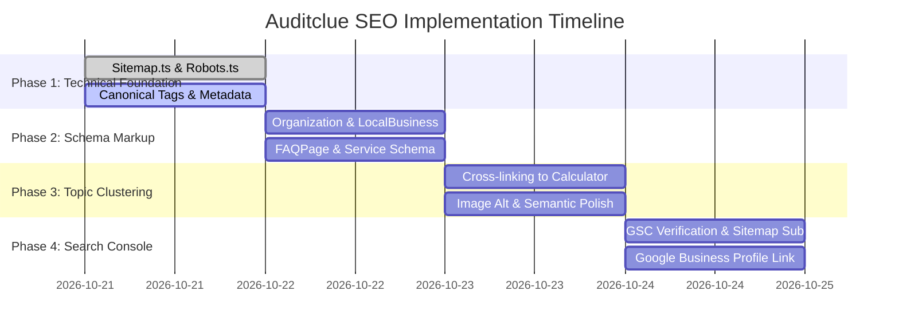

# Auditclue — End-Level On-Page SEO Blueprint & Implementation Roadmap
**Target Market:** UAE (Dubai, Abu Dhabi, Sharjah, Free Zones & Mainland)  
**Technology Stack:** Next.js 16 (App Router + Turbopack + Static Site Generation)  
**Document Version:** 1.0.0  
**Status:** In Progress  

---

## 1. Executive Summary & The "Next.js Unfair Advantage"

Most UAE audit, tax, and company setup competitors (Virtuzone, Shuraa, Jitendra, Farahat, etc.) operate on legacy WordPress or PHP architectures bloated with 40+ plugins, resulting in:
- Slow Time-To-First-Byte (TTFB > 1.8s)
- Poor mobile Core Web Vitals (LCP > 3.5s, CLS shifts)
- Bloated DOM and script execution delays

### Auditclue’s Competitive Superiority:
1. **Sub-second Load Times (<0.8s):** Pre-rendered static HTML (SSG) across all 20 routes.
2. **Perfect Core Web Vitals:** 95–100 Google Lighthouse score on Mobile and Desktop.
3. **Interactive Dwell-Time Engine:** Built-in UAE Corporate Tax & VAT Calculator that keeps users engaged for 2–3 minutes, signaling maximum relevance to Google's ranking algorithms.

---

## 2. The 3 Core Pillars of End-Level On-Page SEO

```
                             ┌──────────────────────────────────────────────┐
                             │    AUDITCLUE ON-PAGE SEO ARCHITECTURE        │
                             └──────────────────────┬───────────────────────┘
                                                    │
         ┌──────────────────────────────────────────┼────────────────────────────────────────┐
         │                                          │                                        │
         ▼                                          ▼                                        ▼
┌─────────────────────────────┐        ┌─────────────────────────────┐        ┌─────────────────────────────┐
│  PILLAR 1: TECHNICAL ENGINE │        │  PILLAR 2: CONTENT & NLP    │        │  PILLAR 3: USER ENGAGEMENT  │
├─────────────────────────────┤        ├─────────────────────────────┤        ├─────────────────────────────┤
│ • Dynamic Metadata          │        │ • Strict H1-H2-H3 Hierarchy │        │ • Interactive Tax Calculator│
│ • Canonical URLs            │        │ • 120+ High-Intent Keywords │        │ • Topic Cluster Cross-Links │
│ • Automated XML Sitemap     │        │ • First 100 Words Relevance │        │ • FAQ Rich Snippets (Schema)│
│ • Robots.txt Directives     │        │ • LSI / Semantic NLP Terms  │        │ • High-Conversion CTA Loops │
│ • Structured JSON-LD Schema │        │ • WebP / AVIF Image SEO     │        │ • Zero Bounce UX Design     │
└─────────────────────────────┘        └─────────────────────────────┘        └─────────────────────────────┘
```

---

## 3. Targeted On-Page Keywords Universe (120+ High-Intent Queries)

### A. Core Brand & Global Terminology (Home Page `/`)
- `Fully digital audit firm UAE`
- `Corporate tax consultant Dubai`
- `Audit and assurance services UAE`
- `Accounting and bookkeeping Dubai`
- `Virtual CFO services UAE`
- `Business advisory firm UAE`
- `UAE VAT compliance services`
- `Company setup advisory Dubai`

### B. Practice-Specific Commercial Clusters

#### 1. UAE Corporate Tax (`/services/corporate-tax` & `/calculator`)
- UAE Corporate Tax Registration (FTA Portal)
- Corporate Tax Return Filing UAE
- 9% Corporate Tax Liability Computation
- Small Business Relief Advisory (Revenue under AED 3,000,000)
- 0% Taxable Income Threshold (Profits up to AED 375,000)
- Corporate Tax Health Check & Impact Assessment
- Qualifying Free Zone Person (QFZP) Assessment
- Related Party Transactions Review & Corporate Tax Documentation
- Tax Loss Relief Carry Forward & Tax Group Advisory

#### 2. Statutory Audit & Assurance (`/services/audit-assurance`)
- Statutory Audit Coordination UAE
- External Audit Readiness Support
- Internal Audit & Risk-Based Audit
- IFRS Compliant Financial Statements Preparation
- Due Diligence Audit & Management Audit
- Fixed Asset Verification & Revenue Assurance Review
- Agreed-Upon Procedures (AUP)

#### 3. Accounting & Bookkeeping (`/services/accounting-bookkeeping`)
- Monthly Cloud Bookkeeping (Xero, QuickBooks, Zoho Books)
- Bank & Credit Card Reconciliations
- Accounts Payable (AP) & Accounts Receivable (AR) Management
- Monthly Management Accounts (MIS Reports)
- WPS-Compliant Payroll Accounting UAE
- Backlog Accounting Clearance & Software Migration

#### 4. UAE VAT Services (`/services/vat-services`)
- VAT Registration & De-Registration
- Quarterly VAT Return Filing (Form 201)
- 5% VAT Calculation UAE
- VAT Health Check & Voluntary Disclosure (VD)
- FTA Tax Audit Representation & Penalty Waiver Reconsideration

#### 5. Business Setup & Formation (`/services/business-setup` & `/services/business-advisory`)
- Mainland LLC Company Setup Dubai
- UAE Free Zone Company Formation (DMCC, IFZA, DAFZA, Meydan, RAKEZ)
- Offshore Company Incorporation
- Trade License Renewal & Amendment
- Corporate Bank Account Opening Support
- Mergers & Acquisitions (M&A) Advisory & Business Valuation

#### 6. CFO Advisory & Compliance (`/services/cfo-advisory`, `/services/transfer-pricing`, `/services/compliance-services`)
- Virtual CFO & Fractional Financial Advisory
- Transfer Pricing Master File & Local File Documentation
- Arm's Length Pricing Benchmarking
- Economic Substance Regulations (ESR) Notification & Reporting
- Ultimate Beneficial Owner (UBO) Compliance Filing
- AML & goAML Registration (Ministry of Economy UAE)

---

## 4. Phase-Wise Implementation Roadmap

To systematically achieve maximum Google search visibility without breaking site health, the technical rollout is structured into **4 focused phases**:



---

### PHASE 1: Technical SEO Foundation & Meta Architecture
**Priority:** Highest | **Impact:** Immediate Crawling & Indexation

| Deliverable | Action Required | Status |
| :--- | :--- | :--- |
| **`src/app/sitemap.ts`** | Build dynamic XML sitemap with all 20 canonical URLs, `lastModified`, `changeFrequency: 'weekly'`, and `priority` scoring. | ⏳ Ready to Deploy |
| **`src/app/robots.ts`** | Implement Googlebot and search crawler allowances with explicit `sitemap: https://auditclue.com/sitemap.xml` reference. | ⏳ Ready to Deploy |
| **Canonical URLs** | Inject `alternates: { canonical: 'https://auditclue.com/...' }` in `layout.tsx` and all service pages to prevent duplicate content flags. | ⏳ Ready to Deploy |
| **Explicit Keywords Array** | Add comprehensive targeted `keywords: [...]` array into Next.js metadata configs. | ⏳ Ready to Deploy |
| **OpenGraph & Twitter Cards** | Standardize `og:locale: 'en_AE'`, `og:siteName`, preview titles, and descriptions across all pages. | ⏳ Ready to Deploy |

---

### PHASE 2: Structured Data & Google Rich Snippets (JSON-LD)
**Priority:** High | **Impact:** Enhanced Search Results (Star Ratings, FAQ Dropdowns, Local Knowledge Graph)

| Deliverable | Action Required | Status |
| :--- | :--- | :--- |
| **Organization & LocalBusiness Schema** | Inject JSON-LD in `layout.tsx` declaring Auditclue as a licensed UAE Financial & Advisory Firm with Dubai coordinates, phone number, and service catalog. | ⏳ Pending Phase 1 |
| **FAQPage Schema** | Add structured `FAQPage` schema on `/calculator` and Home page so Google displays dropdown answers directly in SERPs (People Also Ask). | ⏳ Pending Phase 1 |
| **Service Schema** | Add dedicated `ProfessionalService` schema on each of the 11 practice pages. | ⏳ Pending Phase 1 |
| **BreadcrumbList Schema** | Enable automated breadcrumbs schema so Google displays URL trails (`auditclue.com > services > corporate-tax`). | ⏳ Pending Phase 1 |

---

### PHASE 3: Content Semantic Optimization & Topic Clustering
**Priority:** Medium-High | **Impact:** PageRank Distribution & Dwell Time Amplification

| Deliverable | Action Required | Status |
| :--- | :--- | :--- |
| **Tax Calculator Topic Linkage** | Insert high-converting contextual prompts in `/services/corporate-tax` and `/services/vat-services` linking to `/calculator` ("Calculate your UAE Corporate Tax Liability in 30 seconds"). | ⏳ Pending Phase 2 |
| **Reverse Advisory Linking** | Link the Calculator output page back to specific service consultation forms. | ⏳ Pending Phase 2 |
| **Image SEO & Alt Tag Audit** | Ensure every logo, badge, and graphic has rich, keyword-descriptive `alt` tags (e.g. `alt="Auditclue UAE Corporate Tax & VAT Advisory"`). | ⏳ Pending Phase 2 |
| **LSI Terminology Infusion** | Audit first 100 words of each service client to confirm key statutory terms (FTA, Ministerial Decisions, IFRS, WPS) appear naturally. | ⏳ Pending Phase 2 |

---

### PHASE 4: Search Console Submission & Verification
**Priority:** Final Step | **Impact:** Live Google Indexation Monitoring

| Deliverable | Action Required | Status |
| :--- | :--- | :--- |
| **Google Site Verification** | Add Google Search Console verification meta tag in `layout.tsx`. | ⏳ Final Step |
| **Sitemap Submission** | Submit `https://auditclue.com/sitemap.xml` inside Google Search Console dashboard. | ⏳ Final Step |
| **URL Inspection** | Request priority indexing for Home, Calculator, Corporate Tax, and Audit & Assurance pages. | ⏳ Final Step |
| **Google Business Profile (GBP) Alignment** | Synchronize website NAP (Name, Address, Phone) with Google Maps profile. | ⏳ Final Step |

---

## 5. Ongoing Monitoring & KPI Metrics

To track ranking trajectory once deployed:
1. **Google Search Console:** Total Impressions, Clicks, and Average Position for high-intent queries (e.g., *"corporate tax calculator UAE"*).
2. **PageSpeed Insights:** Maintain 95+ Mobile performance score on Next.js Turbopack build.
3. **Conversion Rate:** Measure WhatsApp consultation clicks and form submissions via Google Analytics 4 (GA4) custom events.
